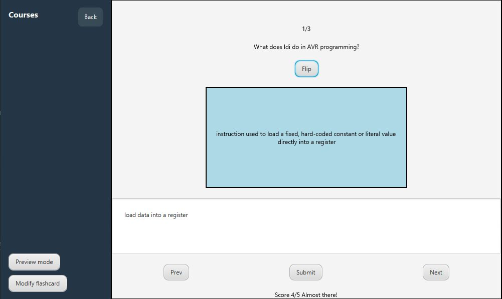
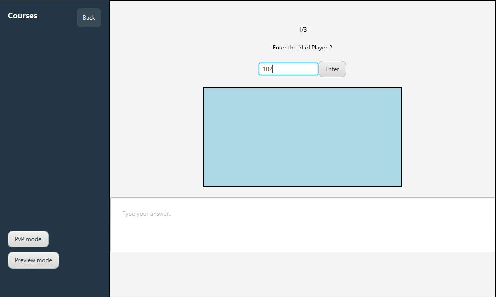
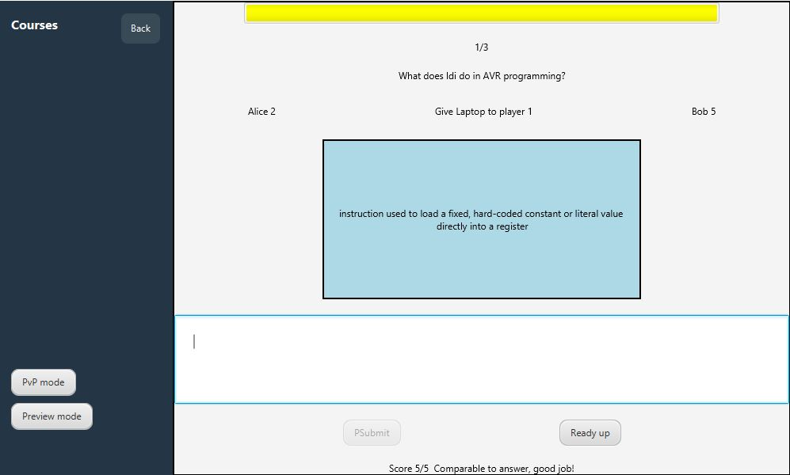
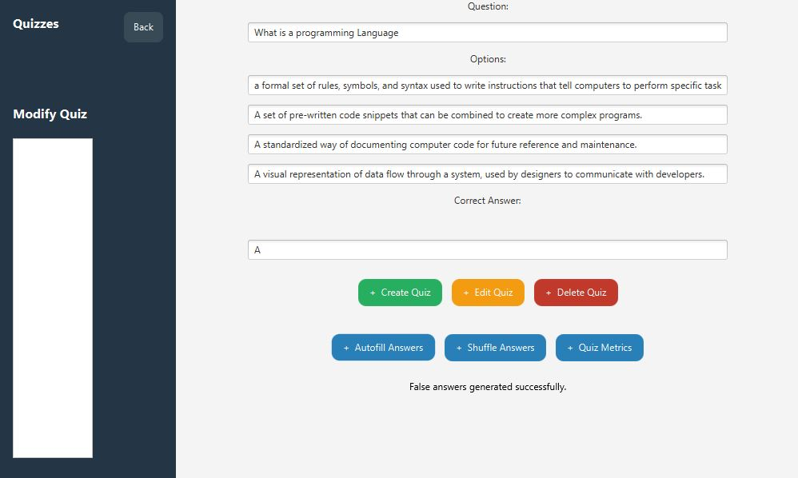

# FLASHWISE

FLASHWISE is a JavaFX flashcard and quiz application designed to help students move beyond simple memorisation. Students can answer flashcards in their own words, receive AI-assisted feedback against a model answer, practise quizzes, and view learning progress. Teachers can create course content, manage flashcards and quizzes, and use generated quiz answers to speed up authoring.

The project was developed as a classroom learning tool with a focus on JavaFX UI design, SQLite persistence, object-oriented architecture, unit testing, and continuous integration.

## Features

- AI-assisted flashcard grading using a local Ollama model.
- Free-form student answers compared against model flashcard answers.
- Teacher workflows for creating, editing, and deleting flashcards and quizzes.
- AI generation of believable false answers for multiple-choice quizzes.
- Student and teacher dashboards with role-specific navigation.
- Course-based organisation for flashcards and quizzes.
- PvP flashcard mode with timed turns, scoring, and winner tracking.
- SQLite-backed persistence for users, courses, flashcards, quizzes, and scores.
- JUnit test coverage for models and persistence logic.
- GitHub Actions workflow for automated tests and Maven builds.

## Screenshots

### Student Dashboard


### AI Flashcard Grading



### PvP Entry



### PvP Mode



### Quiz Authoring and AI Answer Generation



## Tech Stack

- Java 21
- JavaFX 21
- Maven
- SQLite via `sqlite-jdbc`
- JUnit 5
- Ollama with `llama3.1:latest` for local AI features
- GitHub Actions for CI

## Project Structure

```text
src/
  main/
    java/
      com/example/projectcab302/
        Controller/      JavaFX controllers and event handling
        Model/           Course, Flashcard, Quiz, Score, User, Student, Teacher
        Persistence/     DAO interfaces and SQLite implementations
        Utils/           Session and password hashing utilities
        HelloApplication.java
        SceneManager.java
        ViewManager.java
    View/
      com/example/projectcab302/
        *.fxml           JavaFX views
        *.css            Shared styling
  test/
    java/
      com/example/projectcab302/
        *Test.java       JUnit model and persistence tests
images/
  *.JPG                  README screenshots
```

`src/main/View` is configured as a Maven resource directory in `pom.xml`, so FXML and CSS files are copied onto the runtime classpath.

## Architecture

FLASHWISE follows a Model-View-Controller structure.

The `Model` package represents the application's core data types, including courses, flashcards, quizzes, scores, students, teachers, and shared user behaviour. Common user data is captured in the abstract `User` class, while `Student` and `Teacher` extend it for role-specific behaviour.

The `View` layer is built with FXML and JavaFX. Most screens use a `BorderPane` layout with a sidebar-style navigation area and shared CSS styling.

The `Controller` package connects the views to the models. Controllers handle button actions, form input, scene changes, flashcard flipping, quiz submission, PvP timing, and communication with the local AI service.

Persistence is implemented through DAO interfaces such as `IFlashcardDAO`, `IQuizDAO`, `ICoursesDAO`, `IUserDAO`, and `IScoresDAO`. SQLite implementations sit behind those interfaces, keeping database logic separate from the UI and supporting testability.

## AI Features

FLASHWISE uses Ollama locally through HTTP requests to:

- grade free-form flashcard answers on a 1-5 scale;
- compare student responses with the expected answer;
- generate feedback for the learner;
- generate believable false answers for quiz authoring.

The application expects Ollama to be available at:

```text
http://localhost:11434/api/generate
```

The configured model is:

```text
llama3.1:latest
```

## Prerequisites

Install:

- Java 21
- Maven
- Ollama, if you want to use AI features

Pull the local AI model:

```bash
ollama pull llama3.1
```

Make sure Ollama is running before using AI grading or answer generation:

```bash
ollama serve
```

SQLite is accessed through the Maven `sqlite-jdbc` dependency, so no separate SQLite installation is normally required to run the application.

## Running the App

From the project root:

```bash
mvn clean javafx:run
```

The application starts from:

```text
com.example.projectcab302.HelloApplication
```

## Running Tests

Run the JUnit test suite with:

```bash
mvn test
```

The current test suite covers model behaviour and persistence classes, including courses, flashcards, quizzes, scores, users, and SQLite DAO logic.

## Building

Create a Maven package with:

```bash
mvn package
```

Generate Javadocs with:

```bash
mvn javadoc:javadoc
```

The project also includes a GitHub Actions workflow at `.github/workflows/maven.yml` that runs tests and builds the project on pushes and pull requests targeting `main`.

## Development Notes

- `SceneManager` and `ViewManager` centralise JavaFX navigation and dependency passing between controllers.
- Parent controller classes are used to share injected state such as the active user, selected course, and next FXML target.
- JavaFX `Timeline` is used for timed UI behaviour such as PvP rounds and dashboard metrics.
- The AI features require a local model and will not work unless Ollama is running.
